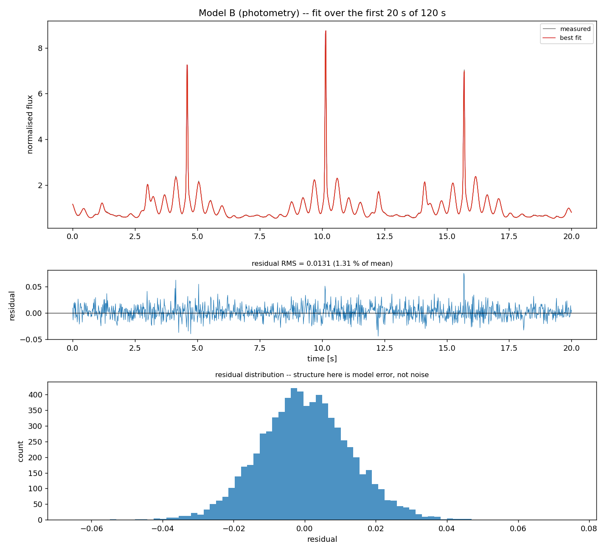
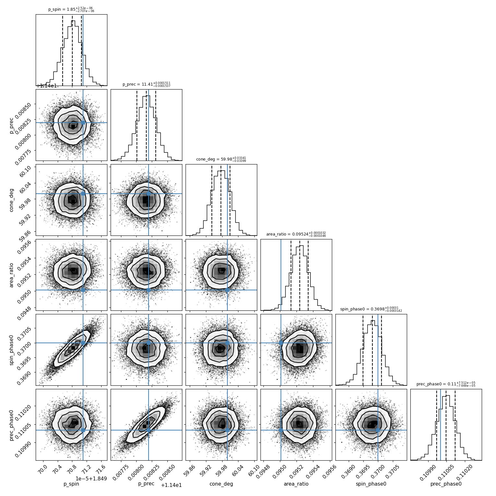
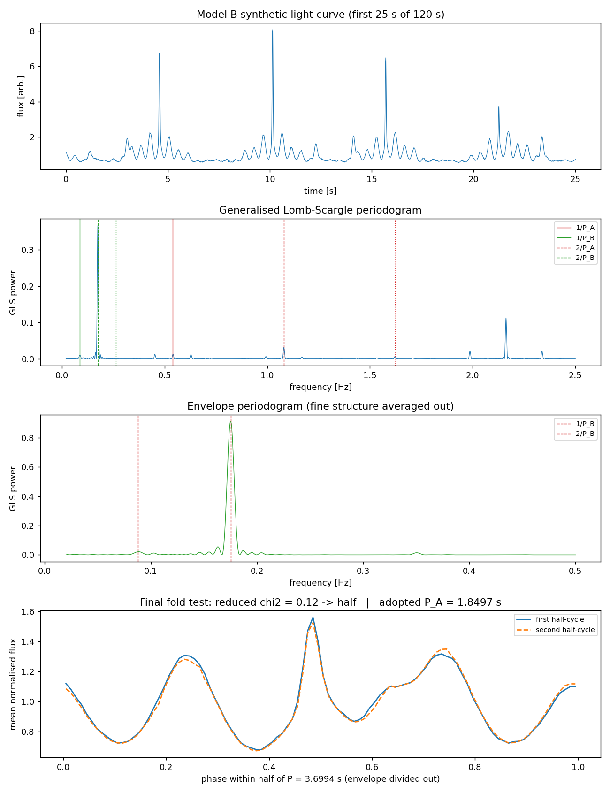
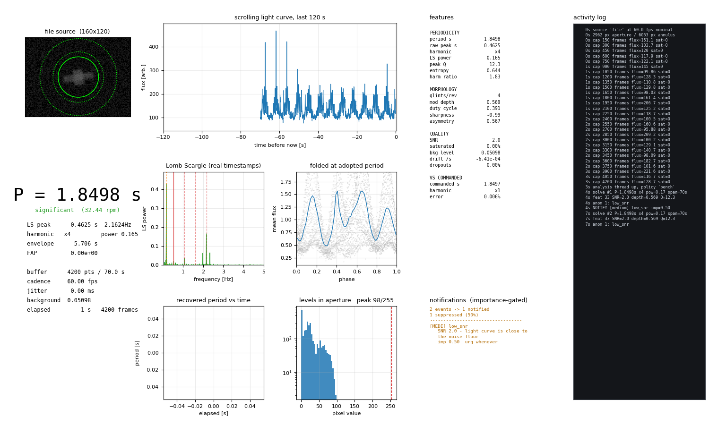
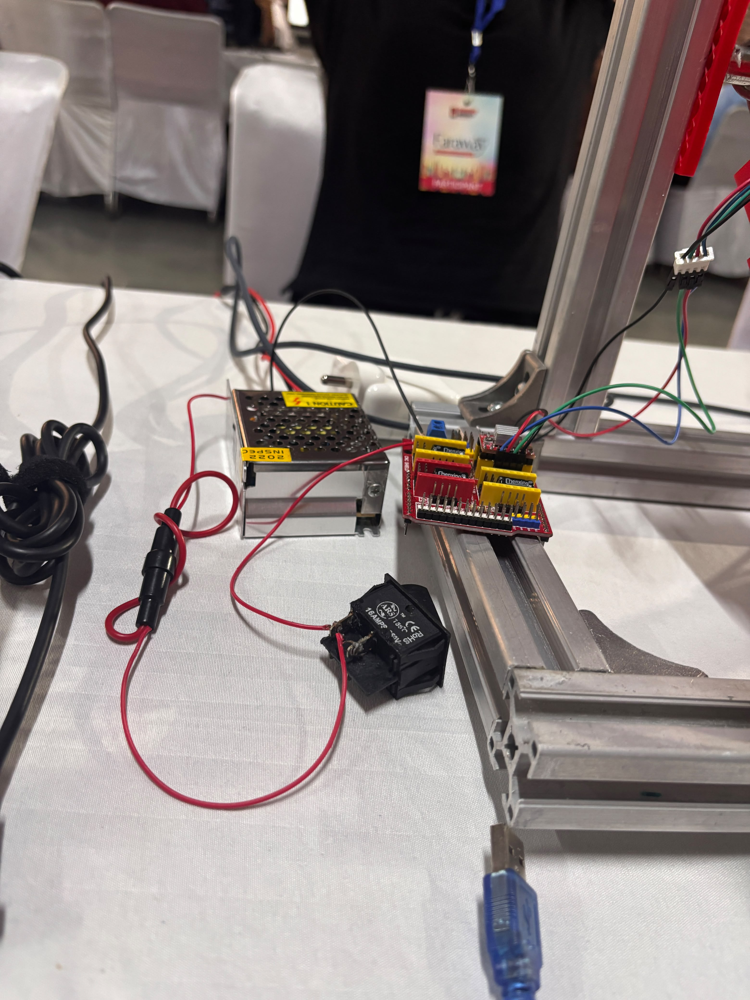
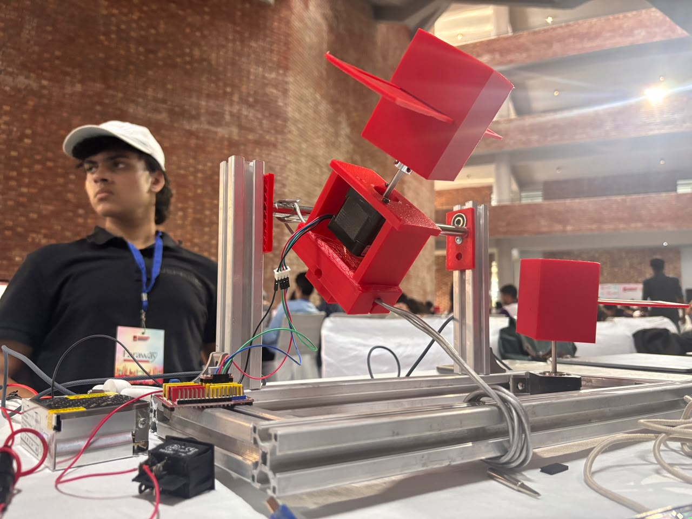
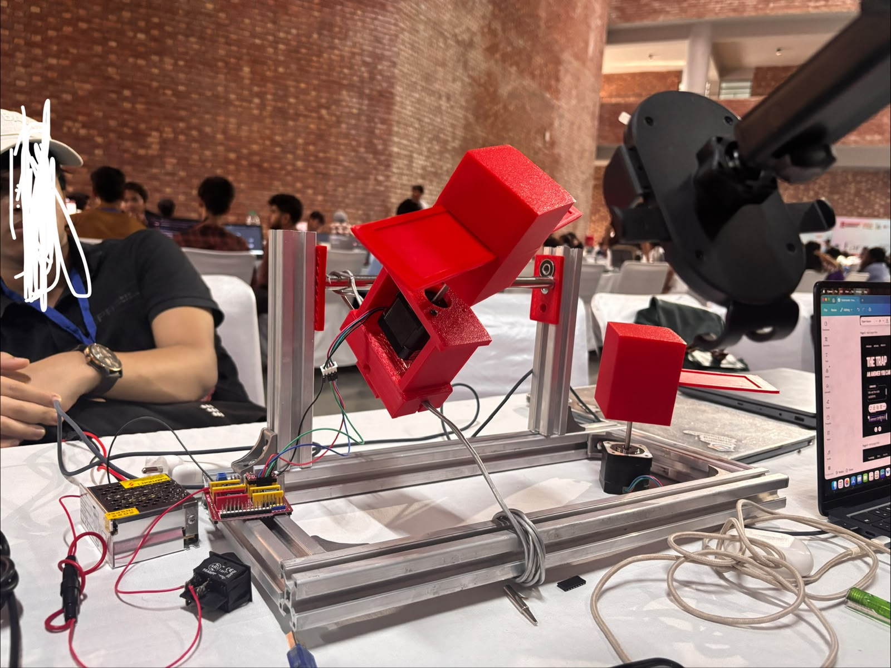
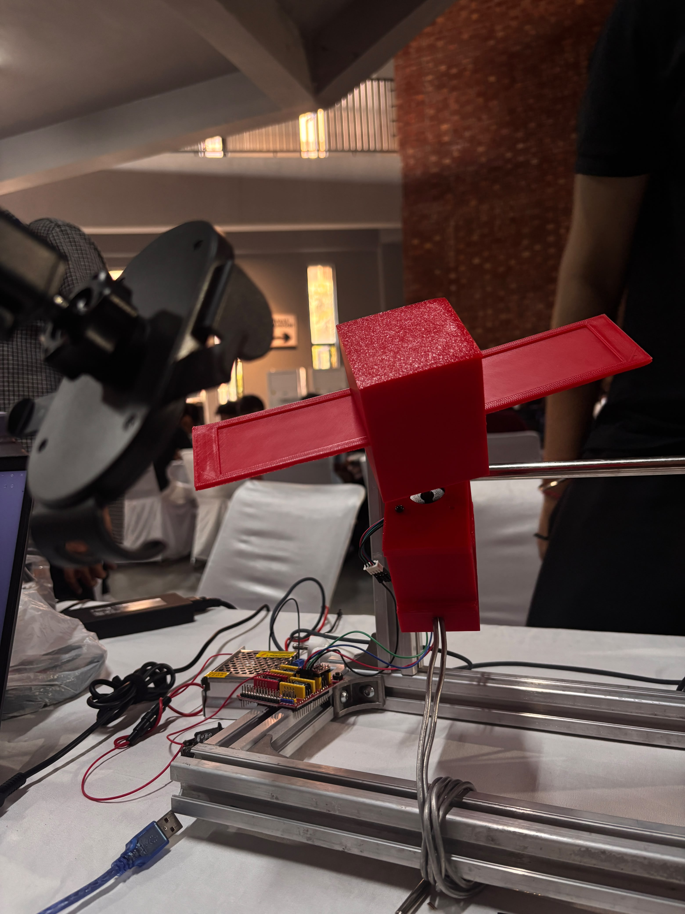

# SPINDEX

### **Spin** **D**etermination by **INDEX** of Reflected Light

**A live guidance feed for robotic spacecraft—often called "space tugs" or servicers(are actively approaching, docking with, and modifying the orbits of dead or dying satellites) that have to catch something already
spinning.**

SPINDEX watches a target's reflected brightness and continuously solves for how
it is tumbling — rotation period, precession, cone angle, and coarse geometry —
from that light alone. No transponder. No cooperation from the target. No prior
knowledge of what it is.

---

## Why anything needs this

Robotic servicers — **space tugs** — are no longer theoretical. Astroscale's
ADRAS-J flew to a spent Japanese upper stage in 2024. Northrop Grumman's Mission
Extension Vehicles have already docked with live commercial satellites and taken
over their station-keeping. ClearSpace-1 is being built to capture and deorbit a
rocket adapter. These vehicles approach dead or dying satellites, physically
grapple them, and change their orbits.

**Every one of those missions has to solve the same problem first: the target is
tumbling, and the tug has to match it before it can touch it.**

That is a genuinely dangerous manoeuvre. Approach a tumbling derelict with the
wrong spin solution and you get one of:

- **Momentum transfer** — grapple a body whose rotation you have not matched and
  its angular momentum becomes yours. If it exceeds what your wheels and
  thrusters can dump, you now have two tumbling spacecraft instead of one.
- **Fragmentation** — a mistimed contact on a fragile, decades-old structure
  breaks it apart, creating thousands of new debris objects. That is the precise
  opposite of the mission's purpose.
- **Propellant exhaustion** — matching an unexpected tumble costs fuel that was
  budgeted for the rest of the mission.

And spin states are not static. They evolve through eddy-current damping against
Earth's magnetic field, internal energy dissipation, solar radiation pressure and
gravity-gradient torque. **A characterisation from three years ago is stale by
the time the tug arrives.**

So the servicer needs two things: a spin solution early enough to design the
capture mechanism around, and a *live, continuously updated* one during terminal
approach to confirm the target is still doing what the plan assumed.

**SPINDEX produces that feed.**

---

## How it works

A derelict emits no light of its own. It is metal and composite reflecting
sunlight, exactly as the Moon does. Because it is not spherical — solar panels, a
boxy bus, antennas — the fraction of light it directs toward an observer depends
on its instantaneous orientation. A flat solar panel turning face-on produces a
sharp specular glint; the same panel edge-on returns almost nothing.

As the body rotates, that fraction varies. Recording brightness against time
produces a **light curve** whose rhythm, harmonic content and profile shape
encode the rotation rate, the orientation of the spin axis, and coarse
information about the reflecting geometry.

SPINDEX inverts that: brightness in, spin state out, updated live, with
uncertainties on every number.

The measurement needs nothing but a camera and a light source. That is what makes
it cheap enough to run against many targets, and simple enough to run onboard an
approaching servicer rather than only from the ground.

---

## The validation problem, and the answer to it

Point this at a real derelict and it will produce a spin period. **Nobody can
tell you whether that number is right**, because the true rotation of an
uncooperative dead satellite is exactly the thing nobody knows. The claim is
unfalsifiable — which makes it worthless as evidence, however good the software
is.

So SPINDEX is validated against a target whose motion is **commanded**. The
rotation rate is set in firmware, the geometry is set by design, and the
inversion is scored against a value that was known before the measurement began.

That is the difference between demonstrating that software produces an answer and
demonstrating that the answer is *correct*. Every result below is scored against
a known truth.

---

## What actually got built

A nine-stage inversion pipeline plus a real-time monitor, developed and validated
entirely against synthetic data before any hardware existed — which is what let
the science get finished while parts were still in transit.

```
  forward model  ->  rendered frames  ->  H.264 video
                                              |
                                       ffmpeg extraction  (+ CFR audit)
                                              |
                                       aperture photometry
                                              |
                                       Lomb-Scargle period search
                                              |
                                       harmonic resolution (P vs P/2)
                                              |
                                       least squares  ->  emcee posteriors
                                              |
                                       scored against commanded truth
```

The **live path** is the one that matters operationally: camera in, spin solution
out, continuously, with nine panels of diagnostics and an importance-gated
notification system that tells an operator when the target's state has *changed*
— a spin-up, a spin-down, a shift in the tumble — rather than burying them in a
stream of routine updates.

That distinction is the whole point of a guidance feed. A servicer on terminal
approach does not need to be told the target is still doing what it was doing
five seconds ago. It needs to be told the instant it stops.

---

## Results

Every number below was measured by the code in this repository, fitted to a
light curve that went through rendering, H.264 compression, `ffmpeg` extraction
and aperture photometry. The forward model never saw any of that.

**Commanded:** spin period 1.84971 s, precession 11.40820 s, cone angle 60°.

| | Model A (symmetric) | Model B (asymmetric) |
|---|---|---|
| Spin period **P_A** | 1.84971 ± 0.00000 s (−0.000 %) | 1.84971 ± 0.00000 s (−0.000 %) |
| Precession **P_B** | 11.40822 ± 0.00017 s (+0.000 %) | 11.40816 ± 0.00015 s (−0.000 %) |
| **Cone angle** | 60.019 ± 0.056° (+0.031 %) | 59.976 ± 0.034° (−0.041 %) |
| **Panel:bus area ratio** | 0.19105 ± 0.00024 (+0.539 %) | 0.09524 ± 0.00010 (+0.237 %) |
| Photometry fidelity (Pearson *r*) | 0.999559 | 0.999702 |
| χ²_red | 3.29 | 1.55 |
| Truth inside 68 % interval | 4/6 | 4/6 |

4 of 6 is the expectation for a well-calibrated posterior — the intervals are
neither optimistic nor padded.



*The fit against the curve measured off rendered video. Orange traces are draws
from the posterior. The residual panel and its distribution are what chi2_red
1.55 looks like — structure at that level is model error, not noise.*



*Posterior distributions for all six fitted parameters, with commanded truth
marked in blue. Off-diagonal panels show the parameter correlations; the tight,
well-separated posteriors on the two periods are why they are quoted to five
decimal places.*

**Robustness:** 78/80 across noise 1–10 %, five random seeds, both target models.
The two failures are 60 s recordings at 10 % noise; every 120 s case passes,
which is the minimum recording length the design specifies earning its place.

---

## The interesting part: P versus P/2

A symmetric satellite glints **twice** per revolution, so the strongest peak in
the periodogram sits at `2/P`, not `1/P`. Report that peak and your period is
half the truth. Resolving it is mandatory, not a refinement.

The standard fix — fold the curve at `P` and at `2P`, see which is
self-consistent — is not sufficient, and finding out why was the most
interesting part of this build:

**One test is not enough.** With realistic bus proportions the dominant peak
lands at `4/P`, not `2/P`. The test has to climb repeatedly until doubling stops
paying.

**The envelope contaminates the test.** Because the spin axis is also rocking,
consecutive rotations differ in *height*. Compared bin by bin they always look
different, so a naive test says "these differ" every round and doubles the period
forever. Each round now divides out a boxcar one fold-window wide first.

**The null must be empirical.** Measured against photon errors alone, every pair
of half-cycles looks significantly different — samples in one phase bin come from
many rotations at many rock angles and scatter for a *physical* reason too. The
test uses the empirical standard error, floored at the photon error.



*Top to bottom: the synthetic light curve with its glints; the Lomb-Scargle
periodogram with 1/P_A, 2/P_A and the envelope harmonics marked; the envelope
periodogram after the fine structure is averaged out; and the fold test itself —
the two half-cycles overlaid, reduced chi2 = 0.12, so doubling buys nothing and
the walk stops.*

The result: Model A correctly reports that it can only constrain `P_A/2` — a
symmetric target is genuinely degenerate, and saying so is the right answer.
Model B's asymmetry breaks the degeneracy and the walk recovers the full period
from photometry alone.

---

## Import/Export: Importance-Based Notification Rule

Detection is cheap; notification is expensive. A 10-minute run produces a
solution every second, and forwarding every anomaly guarantees the operator stops
reading — so the one event that mattered scrolls past unnoticed.

The rule is therefore **not** "notify on anomaly" but *"notify when an event
clears an explicit, written-down bar"*, and every decision records why.

```
importance = severity x confidence x max(novelty, persistence) x kind_weight
```

Novelty and persistence combine as `max`, not a product: an event matters if it
is *either* new *or* entrenched. Multiplying would suppress both the first
occurrence (no streak yet) and the hundredth (no novelty left) — precisely
backwards.

Seven ordered gates: mute → always-notify → severity floor → threshold →
cooldown → quiet hours → rate limit. Urgency is a separate axis driving channel
routing and quiet-hour overrides.

**Session archives** carry SHA-256 checksums, schema version, provenance and the
policy that produced their decisions. Import verifies all of it and raises events
for tampering, truncation, non-monotonic timestamps and schema drift — gated
through the same engine as live events. One bar, one audit trail.

| Scenario | Result |
|---|---|
| Healthy runs, 8 seeds | **0 false alarms** |
| Injected spin-down, 8 seeds | **8/8 detected** |
| Faulted run | 26 events → 8 notified (69 % suppressed) |
| Test suite | **44/44 pass** |

Full design note: [`docs/NOTIFICATION_RULES.md`](docs/NOTIFICATION_RULES.md)

---

## Live monitor — the guidance feed



```bash
python pipeline/live.py --source 0 --window 120
```

This is the part a servicer would actually consume: a spin solution that updates
continuously as the target is observed, rather than a report written after the
fact.

Nine panels updating in real time: camera with aperture overlay, scrolling light
curve, big period readout, periodogram with harmonic markers, phase fold, period
history, pixel-level histogram, live feature table, importance-gated notification
feed, and a scrolling activity log.

Every solution carries a false-alarm probability, and the readout **greys itself
out when the period is not statistically significant**. A guidance feed that
cannot say "I don't know yet" is more dangerous than no feed at all — a servicer
acting on a confident-looking wrong number is exactly the failure this is meant
to prevent.

**The time base is different from the recorded pipeline, deliberately.** A locked
60 fps recording is uniform by construction, so frame index *is* the clock. A
webcam is not: it drops frames and USB scheduling jitters arrival times. Every
live sample is stamped with `time.perf_counter()` at grab time and Lomb-Scargle
is fed real timestamps — which is exactly why Lomb-Scargle is the right tool and
an FFT is not.

Works with a webcam, an OBS Virtual Camera (phone via USB — see
[`docs/OBS_SETUP.md`](docs/OBS_SETUP.md)), a recorded file, or a fully synthetic
source needing no camera at all.

---

## The hardware


*The assembled instrument. 2020 aluminium frame, printed PETG cradle carrying
Motor A, target mounted on the hub, and the Axis B shaft running through
bearing blocks in both posts. Power supply and controller sit on the base rail
at left; a second target stands on its own post at right.*

SPINDEX is validated against a bench instrument that produces a *commanded*
tumble — the whole point being that the answer is known before the measurement.
Three subsystems, connected by a single signal path.

```
  [1] TARGET SIMULATOR            [2] OPTICAL SENSING        [3] INVERSION
  Arduino Uno + CNC Shield        COB LED @ 30 deg phase     Python pipeline
  2x NEMA 17 + drivers            iPhone/webcam @ 60 fps     this repository
  Axis A: spin                    light-sealed enclosure
  Axis B: rock the spin axis                |                       |
        |                                   |                       |
        +--- slot sensor -------------------|--- ground truth ------+
             (independent timing channel, bypasses the optical chain)
```

Axis A rotates the target continuously. Axis B rocks the entire cradle carrying
Axis A through ±60°, sweeping the spin axis through the observer's frame. Two
incommensurate frequencies — the signature of genuine **non-principal-axis
tumbling**, which is what real derelicts do, rather than a trivial single-axis
spin any FFT solves in one line.

### Motion and control



*Control electronics: 12 V SMPS, CNC Shield V3 with the stepper drivers in the
X and Y sockets, inline fuse and rocker switch on the 12 V rail, and the USB
link to the host. Motor leads run out to the cradle through the flexing service
loop rather than a slip ring.*

| Item | Specification | Qty | Role |
|---|---|---|---|
| Stepper motor | NEMA 17 · 17HS4401 · 1.8° · 40 N·cm · 1.5 A/phase · 4-wire bipolar · 5 mm shaft | 2 | Axis A spin, Axis B tilt |
| Stepper driver | TMC2209 StepStick (UART/legacy STEP-DIR) with heatsink | 2 | Microstepped motion |
| Controller | Arduino Uno R3 (ATmega328P) | 1 | Motion control + sensor timestamping |
| Driver carrier | CNC Shield V3 — 4 × StepStick sockets, screw terminals, microstep jumpers | 1 | Exposes STEP/DIR and limit headers |
| Power | SMPS 12 V · 5 A · 60 W, centre-positive barrel | 1 | Single regulated rail for motors + LED |
| Protection | Inline fuse 3 A + SPST rocker switch | 1 ea | Isolates the 12 V rail before touching motor connectors |

**Why TMC2209 and not A4988** — this is a measurement decision, not a comfort
upgrade. An A4988 at coarse microstepping produces measurable **cogging**: a
periodic variation in instantaneous rotation rate, locked to the step frequency.
A periodic rate ripple is *indistinguishable from a real periodic signal*. It
appears in the periodogram as a spurious peak, and you spend days chasing a
frequency generated by your own motor. The TMC2209 in StealthChop with 1/16
microstepping and 256-step interpolation keeps that artefact below the
measurement floor.

### Transmission and structure



*The cradle in detail. Motor A is mounted inside it, driving the target through
the hub above; the whole assembly pivots on the Axis B shaft, which is what
sweeps the spin axis through the observer's frame and gives the light curve its
second, incommensurate frequency.*

| Item | Specification | Qty |
|---|---|---|
| Drive pulley | GT2 20 T · 5 mm bore · 6 mm belt | 1 |
| Driven pulley | GT2 60 T · 8 mm bore — gives the **3:1 reduction** | 1 |
| Belt | GT2 closed loop · 280 mm (140 T) · 6 mm | 1 |
| Bearings | 608ZZ · 8 mm ID · 22 mm OD, shielded | 4 |
| Axis B shaft | Ground steel · 8 mm dia × 200 mm · h6 | 1 |
| Shaft collars | 8 mm bore, constrain end float (~0.2 mm axial play) | 2 |
| Target hub | Aluminium, 5 mm bore, M3 grub screw | 1 |
| Frame | 2020 T-slot extrusion: 400 mm × 2, 210 mm × 2, 200 mm posts × 2 | — |
| Cradle | 3D-printed PETG U-bracket + counterweight (M8 washers on a stud) | 1 |

**Why a rocking cradle rather than a full gimbal.** A continuously rotating
second axis needs power and signal to cross a rotating joint — a slip ring, which
brings friction, contact noise on the sensor line, and another failure mode.
Because Axis B never exceeds ±60°, the cables serving Motor A and the slot sensor
pass through a fixed service loop that **flexes rather than wraps**. Same
kinematic benefit, one component and one failure mode removed.

**Cradle balance matters more than it looks:** an unbalanced cradle loads Motor B
asymmetrically, producing a rate error that is periodic *at the Axis B
frequency* — precisely the frequency being measured. Counterweight until it holds
any position with power removed.

### The slot sensor — the ground-truth channel

**The cheapest item in the build and one of the two or three most important.**

| Item | Specification |
|---|---|
| Sensor | IR slot / opto-interrupter module · LM393 comparator · 5 V · digital OUT · 10 mm slot |
| Encoder tab | 15 × 10 × 1 mm opaque, printed, fixed to the target hub |
| Wiring | OUT → **D9** (X+ limit header) · VCC/GND → **5 V / GND** (never the 12 V rail) |
| Spare | Mandatory — this is a critical measurement path |

A tab fixed to the target hub breaks the sensor's beam **once per revolution**.
The controller polls D9 every loop iteration and, on each rising edge, prints the
`micros()` value over USB. The host records that stream alongside the video.

**Why this exists.** It measures the true rotation period of Axis A through a
*completely independent physical channel* — no camera, no lens, no codec, no
photometry, none of the analysis in this repository. When the inversion reports a
period, it is scored against this number.

Without it, the project can only demonstrate that its software produces an
answer. With it, the project demonstrates that the answer is **correct**. That
distinction is the entire difference between a demonstration and a measurement.

**Timing budget:** polling the pin inside the stepper loop gives edge resolution
of order 20–100 µs. Against a 1.85 s period that is a fractional error below
**0.006 %** — far finer than the optical inversion will ever achieve. The
reference channel is therefore not the limiting term in the comparison, which is
exactly the property a reference must have.

Reduction is handled by [`pipeline/serial_log.py`](pipeline/serial_log.py), which
also handles the `micros()` rollover at 2³² µs (~71.6 minutes) and screens for
dropped edges. It reports two estimates deliberately: a screened **mean** of
intervals, and the **slope** of a straight-line fit through timestamp against edge
number. The slope is more precise, but it counts edges — so a *dropped* edge makes
it read one revolution as two and biases it high (measured: 1.8937 s against a
true 1.8497 s). The mean screens the bad interval out. The tool detects the
rejection and tells you which number to trust.

### Illumination and optics



*The optical geometry, with the camera arm at upper right looking across at the
target. In this photograph the instrument is on an open bench under ambient
hall lighting; measurement runs require the light-sealed enclosure and the
single DC-driven COB source described above.*

| Item | Specification | Why |
|---|---|---|
| Lamp | COB LED · 10 W · **12 V DC direct-drive** · ~5000 K | Never mains-driven, never PWM-dimmed |
| Heatsink | 40 × 40 × 11 mm finned, thermal adhesive | An unheatsunk COB droops over minutes, adding a downward trend to every light curve |
| Enclosure | Matte black cloth/chart paper lining, foam-board baffle, taped seams | Stray light must sit below 2 % of target peak |
| Reference | Printed grayscale step wedge, kept in frame | Camera response linearisation |
| Camera | iPhone at 60 fps with **all automation defeated**, on a tripod at 400 mm | — |
| Geometry | **30° phase angle** between illumination and viewing | — |

**The flicker trap.** A mains-powered LED floodlight must not be used. Cheap LED
floods run from rectified mains and modulate at 100 Hz; recording at 60 fps
produces a beat that appears in the light curve as a strong periodic signal which
is *entirely an artefact of the lighting*. It looks exactly like a real detection
— a team could report a spurious period and defend it confidently. A 10 W COB on
the same regulated DC rail as the motors removes the problem for about ₹250.

**Why 30° and not 0°.** Putting the lamp beside the camera maximises returned
flux, and is wrong twice over: the camera physically shadows the target, and at
near-zero phase most surfaces show opposition brightening that compresses the
contrast between specular and diffuse components — which is the very contrast
being measured.

### Target models



*The Model A target: a symmetric box-wing, central bus with two opposed panels.
This is the geometry that glints twice per revolution and therefore puts its
dominant periodogram power at 2/P_A — the harmonic ambiguity the pipeline has
to resolve.*

> **Printed but not yet surfaced.** These are bare PLA. Section 9.1 of the
> specification is explicit that printing alone is not enough: bare PLA is close
> to a uniform Lambertian diffuser in every direction and yields a low-contrast,
> nearly featureless curve with little to invert. The measurement depends on the
> *contrast* between a strongly specular panel and a diffusely reflecting bus, so
> the bus needs creased aluminised mylar and the panels need a blue transparent
> facing before a scoring run. Until then the recovered period will still be
> correct — periodicity survives low contrast — but modulation depth, glint
> sharpness and the panel-area ratio will all be degraded.

Two are printed. **Model A** is a symmetric box-wing with two opposed panels —
the baseline, and the harmonic-ambiguity test case. **Model B** carries a single
panel plus an offset dish, deliberately breaking rotational symmetry.

Printing is not enough: bare PLA is a near-uniform Lambertian diffuser and
produces a low-contrast, featureless curve with almost nothing to invert. The bus
is wrapped in **deliberately creased aluminised mylar tape** — the creasing gives
the irregular multi-lobed scattering of real multilayer insulation rather than a
single mirror facet — and the panels are faced with **blue transparent acrylic**
to produce the flat, strongly directional specular return that generates the
glints.

| | Model A | Model B |
|---|---|---|
| Geometry | Symmetric box-wing, two opposed panels | Single panel + offset dish |
| Glints per revolution | Two | One dominant + weaker secondary |
| Harmonic signature | Strong power at 2/P_A | Strong power at 1/P_A |
| Purpose | Baseline; harmonic-ambiguity test | Shape discrimination |

**The bus cross-section must not be square.** A square bus is 90°-symmetric about
the spin axis, which puts dominant periodogram power at 4/P_A and turns a two-way
harmonic ambiguity into a four-way one. Found while building the forward model.

### Wiring and pin map

| Function | Arduino pin | Shield location | Notes |
|---|---|---|---|
| Axis A STEP | **D2** | X socket | Motor A — target spin |
| Axis A DIR | **D5** | X socket | — |
| Axis B STEP | **D3** | Y socket | Motor B — cradle tilt via 3:1 belt |
| Axis B DIR | **D6** | Y socket | — |
| Driver ENABLE | **D8** | Common | **Active LOW.** Drive HIGH to release both motors |
| Slot sensor OUT | **D9** | X+ limit header | Polled every loop, rising edge timestamped |
| Sensor power | 5 V / GND | Shield power header | Never from the 12 V rail |
| Z socket | D4 / D7 | — | Unused; do not fit a third driver |
| Motor rail | Screw terminal | Shield | Via 3 A fuse then the rocker switch |

**Microstepping — 1/16.** Note this differs by driver family, and getting it
wrong silently doubles every rate:

| Driver | Jumpers needed for 1/16 |
|---|---|
| TMC2209 | 2 (MS1 + MS2) |
| A4988 | **3** (MS1 + MS2 + MS3) |

### Derived motion constants

| Quantity | Value | Derivation |
|---|---|---|
| Full steps per motor rev | 200 | 1.8° step angle |
| Microsteps per motor rev | **3,200** | 200 × 16 |
| Microsteps per Axis A rev | 3,200 | direct drive, 1:1 |
| Microsteps per Axis B rev | 9,600 | 3,200 × 3 (60 T driven by 20 T) |
| Axis B resolution | 0.0375° / microstep | 360° ÷ 9,600 |
| Axis B sweep, ±60° | 3,200 microsteps **total** (±1,600 from centre) | 120° ÷ 0.0375° |
| Axis A rate for P_A = 1.85 s | **1,730 steps/s** | 3,200 ÷ 1.85 |
| Axis B rate for P_B = 11.4 s | **561 steps/s** | 4 × 1,600 ÷ 11.4 |

> **Two corrections to the published spec, found by building it.** Appendix A.3
> lists "±60° → 3,200 microsteps"; that 3,200 is *total peak-to-peak* travel, so
> the amplitude from centre is **1,600**. Taking it as ±3,200 rocks the cradle
> ±120°, double the travel the flexing service loop was sized for. And the same
> table's "842 steps/s" for Axis B disagrees with its own stated derivation,
> which gives **561** — the value the firmware uses.

### Firmware

[`firmware/spin_testbed/spin_testbed.ino`](firmware/spin_testbed/spin_testbed.ino)
— AccelStepper `runSpeed()` on both axes, triangular reversal on Axis B position,
D9 polled every iteration with `micros()` printed on the rising edge, serial
command port at 115200.

The main loop does **four things only**: step A, step B, poll D9, read one serial
byte. Anything else added there shows up as jitter in the light curve. Serial
transmission is interrupt-driven and the ~12 bytes emitted once every 1.85 s never
fill the 64-byte TX buffer, so the pulse print does not block — and `Serial.flush()`
must never be called there.

| Command | Effect |
|---|---|
| `A<rate>` | Axis A rate, microsteps/s (e.g. `A1730`) |
| `B<rate>` | Axis B rate; `B0` parks Axis B for single-axis bring-up |
| `S<amp>` | Axis B sweep amplitude from centre; warns above ±60° |
| `R` / `H` | Run / halt |
| `E0` / `E1` | Release / engage both drivers |
| `Z` | Zero the Axis B position counter at the current position |
| `?` | Report configuration |

### Build status

Stated plainly, because an instrument whose limits are declared is more credible
than one whose limits are discovered by the examiner.

| Subsystem | Status |
|---|---|
| Frame, cradle, transmission | **Assembled** |
| Motors, drivers, shield, power | **Wired and running** |
| Firmware | **Written, compiles, flashes, verified over serial** |
| Drivers fitted | **A4988** in place of the specified TMC2209 — expect cogging artefacts in the periodogram until swapped |
| Controller | **Failed during bring-up**; replacement on order |
| Slot sensor | **Not yet fitted** |
| Second axis | Available but parked — currently single-axis |

**What the missing slot sensor costs, precisely:** without it the reference is the
*commanded* step rate rather than an independent measurement. That is still a
known number and the inversion is still scored against it — but a commanded rate
cannot detect a stalled or step-skipping motor. A stall would read as a clean
period at the wrong value. Fitting the sensor closes that gap, and the host-side
reduction is already written and tested against replayed and synthetic pulse
trains.

**The analysis is unaffected by any of this.** Every result in this repository is
validated against synthetic data and rendered video with known ground truth, which
is why the science was finished while the hardware was still in pieces.

---

## Quick start

```bash
pip install -r requirements.txt

# full chain, synthetic -> video -> photometry -> period, scored against truth
python pipeline/run_pipeline.py --model B

# stages 7-9: least squares + MCMC posteriors against the measured curve
python pipeline/validate.py --model B --from-photometry

# live monitor
python pipeline/live.py --list-devices
python pipeline/live.py --source 0 --window 120

# features + anomalies + importance-gated notifications + archive
python pipeline/analyse.py --csv data/serial/run01.csv --expect 1.8 \
       --export data/sessions/run01

# tests
python pipeline/test_notify.py      # 44 checks
python pipeline/test_recovery.py    # 80-case robustness sweep
```

No hardware needed for any of the above.

---

## Repository layout

| Path | Contents |
|---|---|
| `pipeline/` | The SPINDEX inversion chain — 20 modules, [detailed map](pipeline/README.md) |
| `firmware/` | Arduino sketches (Uno + CNC Shield V3, TMC2209/A4988) |
| `docs/` | Build specification, OBS setup guide, notification design note |
| `results/` | Reports and scored comparisons from actual runs |
| `data/` | Generated frames, videos, archives (git-ignored — rebuildable) |

**Key modules:** `forward_model.py` (box-wing reflection), `photometry.py`
(aperture photometry), `period.py` (Lomb-Scargle + harmonic walk),
`inversion.py` (least squares + emcee), `features.py` (33 features),
`importance.py` (notification rules), `session.py` (checksummed archives),
`live.py` + `dashboard.py` (real-time monitor).

---


## Name

**SPINDEX** — **Spin** **D**etermination by **INDEX** of Reflected Light.

The "index" is the light curve itself: a one-dimensional trace of brightness
against time that indexes the full three-dimensional attitude history of a body
nobody can reach, touch, or ask.

---

